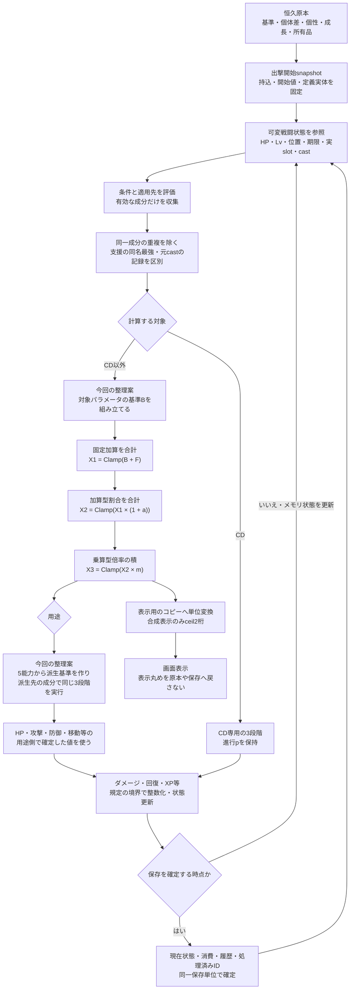
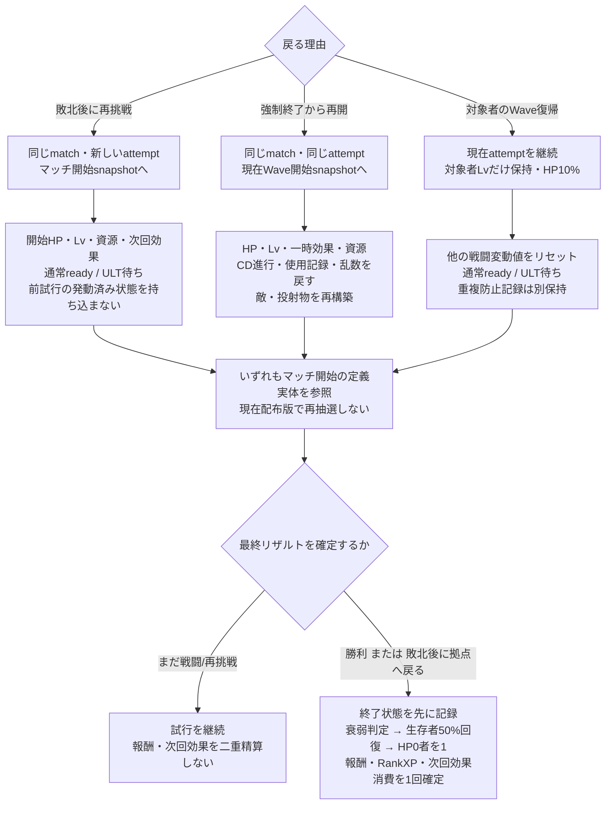

# ステータス・加護・一時効果の演算フロー

- 作成日：2026-10-24
- 現行正式リリース基準：v0.2.0。仕様の入口は従来ファイル名の[引継ぎ](handover_v0.1.0.md)・[仕様状態一覧](specification_status_v0.1.0.md)を引き続き参照する。
- 目的：どの値を原本として残し、いつ条件を判定し、どこで補正・制限・丸めを行うかを、同じ手順で追えるようにする。
- 状態：承認済み規則の整理資料。**「今回の整理案」と記した依存順序・条件評価の細部は未承認の具体化案**。ゲームコード、全台帳の個別性能、実装契約を変更する資料ではない。

## 1. 根拠と確定範囲

Q番号は[ADR1](adr/0001_v0.1.md)・[ADR2](adr/0002_v0.1.md)・[ADR3](adr/0003_v0.1.md)、C/U番号は[仕様状態一覧](specification_status_v0.1.0.md)に対応する。古い設計候補の未確定表現より、後の回答・技術仕様補足を優先する。

| 論点 | 採用済みの規則 | 根拠 |
| --- | --- | --- |
| 数値の原本 | 基礎値・恒久蓄積・計算結果を分け、上限超過分を捨てない。 | Q105〜Q109、C029〜C032 |
| 補正 | 固定加算→加算型割合→乗算。段階内の加算は合計、乗算は積、各段階後にClamp。 | Q107・Q243、C029 |
| 正確さ | Rank/XP/恒久成長はBigInteger、途中補正は厳密Rational。分数のまま保存し用途側で整数化する。 | Q241、[実装技術仕様「数値と乱数」](technical_specification.md#数値と乱数) |
| 合成表示 | 内部・保存の分数は維持。表示だけ単位変換後に小数第2位へ数学的ceil。負の−1.234は−1.23。 | Q228・Q241、C029・C052、[技術仕様に関するユーザー回答](handover_v0.1.0.md#今回の技術仕様に関するユーザー回答) |
| 固定構成と変動状態 | 持込・開始値・定義実体をマッチ開始snapshotへ固定。HP/Lv/一時効果などは戦闘で変化する。 | Q189補足・Q297、C066・C105・C106 |
| 技能の同一性 | 同SkillIDの実S1/S2搭載を許可。CDは使用者・武器・実枠ごと。同一成分のID/枠二重適用はしない。 | Q261・Q262・Q284補足・Q294、C070・C092・C101 |
| 後日更新 | 既存武器の生成基礎値・搭載IDを保持し、Skill効果は次出撃で更新。進行中マッチでは開始定義を使う。 | C105・C106、技術仕様補足 |
| 残る境界 | 個性一覧、条件変化時再判定の細部、個別上限・Lv効果量・属性相性・UNIQUE比較ラインは既存の調整/具体化対象。 | U017・U032・U035・U038・U042・U045 |

U016・U041・U044は解消済みであり、丸め・武器更新を未回答へ戻さない。v0.2.0のtech-*収録は技術検証用であり、技能150・加護453・レシピ300の全件実装を示さない。

## 2. 値と効果の役割

同じ「STR10」でも、生成時の値、成長の蓄積、補正後の値は役割が違う。表示された値で原本を上書きしない。

| 層 | 持つもの・責務 | 変わる契機と扱い | 根拠 |
| --- | --- | --- | --- |
| 基礎定義 | 5能力の基準10、武器基礎値、派生式、各型の上下限。 | 定義の版に属する。出撃中の定義変更は開始snapshotへ流し込まない。 | C024・C025・C076・C106 |
| 初期個体差 | 各能力の−1/0/+1、確率20/60/20%の生成結果。 | 初回生成時の結果を保持し、再計算/読込/再挑戦で引き直さない。 | Q211・Q212、C024 |
| 生来個性 | 加護相当のステータス変化を初期値へ反映し、性格として初期プロフィールへ表す。 | 個体差の後に反映。通常加護6枠とは独立。個性一覧・量・名称対応は未具体化。N001を上限変更へ再定義しない。 | C074、U042 |
| 恒久成長の蓄積 | 恒久イベントによる増減、成長の来歴。BigIntegerで保持。 | 逓減なし、蓄積ハード上限なし。浄化は指定の下降履歴1件の差分のみ取り消す。計算Clampで台帳を削らない。 | C030・C032・C090 |
| 装備 | 所有・装備中の品、生成済み武器基礎値、搭載SkillID、装備由来成分。 | マッチ外で装備変更し、出撃時に構成固定。旧品の生成値/IDは更新で再抽選しない。 | C033〜C038・C105 |
| 通常の加護枠 | 6枠の各加護・I〜III段階・成分・条件・代償/補償。 | 条件不成立でも所持は残し、該当効果だけ外す。合成時も条件/単位/負補償を保持。 | C039・C042・C050〜C052 |
| マッチ内一時効果 | Lv選択強化、時限支援、状態異常、出撃時効果など。 | Lv1開始・上限10、Wave/購入でLvが変化する。各効果の条件/期限を持ち終了規則に従う。必要経験値を一律100とする旧案は使わない。 | C014〜C016・C064・C075・C081 |
| 衰弱 | 終了HP0に応じた累積回数と最大HP減少。 | 装備/加護後のHrefに対し、一時効果と同区分の加算型割合−5%/回。生存/非出撃リザルトで解除。 | C058〜C060 |
| 実行中の状態 | 現在HP、現在Lv/XP、CD進行p、時刻、位置、castID、処理済み記録、乱数状態。 | 最大HP等の計算結果と区別する。HPを再計算のたび満タンにせず、最大HP低下の超過だけ収める。 | C060・C066・C094・C099・C110 |

個体差・個性・恒久蓄積の保存責務を分けることと、計算器へ渡す基準値を組み立てることは別である。個性を既に初期値へ反映したなら、同じ個性成分を実行時加護としてもう一度加えない。

## 3. 全体の流れ

実線の処理列は確定した段階順を示す。**5能力→派生基準→派生側補正という接続位置、および条件変化の観測時点は今回の整理案**であり、第4章で確定部分と分ける。

図の表示分岐は補正後だけに限らない。合成継承成分や基礎値を表示する場合も、各値の正確な原本から表示専用コピーを作る。同じパラメータの3段階を通った結果を、その同じ成分で再び3段階処理する図ではない。原子的にまとめて確定する保存単位と、保存の頻度は別であり、毎20ms/毎hitにDB保存する義務を示さない。通常の再計算はメモリ上の状態を更新する。

### 3.1 条件を満たす成分だけを集める

装備武器、対象SkillID、実S1/S2/ULT、元通常攻撃/元スキル/派生、対象と範囲、HP条件、状態、期限、発動回数など、定義にある条件を評価する。未対応の作用先・条件を持つ有効コンテンツを、黙って常時有効や無効として受け入れない（実装技術仕様）。

- 確定：条件不成立でも加護所持を消さない。通常攻撃限定加護を元スキルへ自動拡張しない。SkillID直接強化は武器や実枠が変わっても同じIDへ作用し、枠強化は実割当を見る（C042・C092・C101）。
- 確定：技能開始直前に対象を検証し、開始前不成立はCD無消費。開始後の共通再標的/返還はしない。通常投射物の攻撃側/会心用能力は発射時、防御/耐性は命中時を使う（C028・C095）。
- 今回の整理案：再計算の入力を同じ観測時点の状態へそろえ、装備・Lv・HP・状態・範囲の変化を契機として必要な値を再評価する。各20ms更新内の細かな順序や、自己の最大HPを変える条件がHP割合を参照する場合の観測点は、Q174/U032の既存具体化範囲に残す。値が安定するまで無制限に再帰計算する方式を確定扱いしない。

### 3.2 「同じ」の単位を混ぜない

| 問題 | 確定した扱い |
| --- | --- |
| 同じ補正成分をID検索と実枠検索で見つけた | その計算では1回だけ適用する。別々の成分まで同SkillIDという理由で消さない（C101）。 |
| 同SkillIDが実S1/S2にある | 2つの有効な搭載であり、両枠を残す。CDは別。同時発動を許す意味ではなく共通始動/硬直に従う（C070・C093）。 |
| 同名の同一支援が複数発信者から届く | 最も強い1つを使う。別系統の補正は通常計算へ渡す（C083）。 |
| 同種状態異常が再付与される | 強度=max(現在,新規)、残時間=max(現在残り,新規時間)。段階加算なし。異種は併存（C082）。 |
| 1技能から多段・継続tick・派生が出た | 元castIDの1回に属する。新使用や自動技能/CD還元を再誘発しない（C099・C101）。 |
| 保存応答が消え同じ操作を再送する | 同一ID/同一内容は受付済み応答を返し、違う内容なら拒否。同一処理をもう一度加えない（実装技術仕様）。 |

今回の整理案として、成分の来歴には発生元インスタンス・成分ID・受け手・計算対象/実枠・元castを識別できる情報を添える。「SkillIDだけの全体集合」で重複排除すると、別枠・別の使用者・別の元行動の正当な効果まで消えるため避ける。これは来歴の説明案であり、保存スキーマの追加決定ではない。

## 4. 3段階の計算と派生値

### 4.1 共通パラメータの確定式

対象パラメータの基準をB、固定加算合計をF、加算型割合合計をa、乗算倍率の積をmとする。Clamp(x,L,U)=max(L,min(U,x))。上限未設定なら下限だけを適用する。能力値・最大HP等の下限は1、確率・資源・ボーナス等は0。未指定上限はU017の既存委任で調整し、例の数値をそのまま採用しない。

1. X1=Clamp(B+F,L,U)
2. X2=Clamp(X1×(1+a),L,U)
3. X3=Clamp(X2×m,L,U)

同じ評価層・同じパラメータの同じ段階にある成分はまとめてからClampし、個別成分ごとに丸め/Clampしない。たとえば+20%と−10%はa=0.1、1.2×0.9という乗算とは別である。固定+2、+2ポイント、割合+2%、倍率×1.02は異なる単位として扱う。成長蓄積や効果の原本はこの計算で変更しない（Q243、C029・C030）。最大HPのHref前と一時効果層は第4.3節の区別を守る。

加算型割合は基準0、乗算型倍率は中立1。合成では倍率そのものではなく1からの差分を継承し、親素材の現在III成分を用いる。前の合成のIII係数を失ったり、合成のたび中立1倍を増やしたりしない（Q228、C052・C088）。

### 4.2 派生式と接続位置を分ける

次の式自体は採用済みである（Q244・Q245・Q247、C076・C077・C079）。

| 派生先 | 基準式 |
| --- | --- |
| 最大HP / 物防 / 魔防 / 回復力 | 100+10VIT / VIT / INT / 5+INT |
| 移動速度 / 攻撃間隔 | 3+0.05AGIマス毎秒 / 武器基本間隔×100/(100+AGI) |
| 剣 / 槍の攻撃値 | 武器基礎W+STR+0.3DEX / W+0.7STR+0.6DEX |
| 槌 / 弓 / 杖の攻撃値 | W+1.3STR / W+0.2STR+DEX / W+1.1INT+0.1DEX |
| 会心率 / 基本倍率 | 5%+DEX×0.1ポイント / 150% |
| 警戒 / 行動 / 支援 | 独立基準4 / 3 / 3マス。射程・弾速は武器定義。 |

**今回の整理案：** まず5能力の「基準＋個体差＋個性＋恒久蓄積」から対象能力の補正を計算し、その用途側で確定した能力を派生式へ渡す。派生式の結果を派生先パラメータのBとし、最大HP補正/物防補正/攻撃値補正など、その派生先を対象とする装備・加護成分を3段階で適用する。

これにより「装備でVIT+2」はVIT側で一度反映して最大HPへ波及し、「最大HP+20」は最大HP側で一度反映する。同じ効果を双方へ二重に入れない。装備や加護という発生元名だけで固定加算/割合/乗算を決めず、各成分の対象と方式に従う。

未確定なのは、この接続位置を全パラメータへ適用する具体ルールや、中間能力の整数化境界、条件が能力へ循環参照する場合の評価点である。式の採用を理由に「全装備補正の後に全加護、その後一時効果」の一列順序まで確定したとはしない（Q174、U032）。上限調整は既存委任を維持する。

### 4.3 最大HPの特別な層

最大HPでは、装備/加護補正後の値を、当該再計算における一時効果前の基準Hrefとして区別して求める。衰弱と一時最大HP補正は同じ加算型割合区分へ集め、−5%と+5%を相殺させる。装備/加護までの層と、一時効果の層を識別して、Href算定済みの成分を再適用しない（Q133・Q232、C059・C060）。Hrefの区別は、戦闘中のLvやHPを開始値へ固定する意味ではなく、条件変化を観測する細かな時点は今回の整理案の範囲である。

一時効果後の最大HP下限はmax(1,ceil(0.01Href))。現在HPは0を許し、最大HPが下がり現在HPが超えた場合だけ超過を収める。最大HPが上がったことだけでは汎用の全回復を発生させない。Lv「活力」の増加分回復はその効果固有の調整表であり、すべての最大HP補正へ拡張しない（C060・C075、U032）。

## 5. 用途ごとの確定境界

共通計算器の出力を直ちにすべて整数へ変換しない。HP・ダメージ・XP・時間・位置には異なる役割がある。

| 用途 | 計算と確定の扱い | 根拠 |
| --- | --- | --- |
| 原本・成長・XP | Rank/XP/恒久蓄積をBigIntegerで保存。途中補正はRational。Clamp結果で蓄積を書き換えない。 | C029・C030、実装技術仕様 |
| 能力・ダメージ・XPの最終値 | 原則floor。負数のfloorは0方向の切捨てとは違い、−1.234なら−2。実際の型別下限も守る。 | Q241、C029・C031 |
| 下限・復帰HP | Href1%保証と復帰HP10%はceil。復帰HPは現在最大HPを参照し、戦闘不能の現在HP0とは区別。 | C060・C061 |
| 合成内部 | 素材IIIの分数成分を合算/保持しI=2/3・II=1・III=4/3。保存も分数。 | C052・C088 |
| 合成表示 | 表示単位へ換算後、ceil(値×100)/100。内部比率を%へ直すなら先に×100。表示文字列を次の合成/保存の入力へ戻さない。 | 技術仕様補足、解消済みU016・U044 |
| 攻撃ダメージ | 属性成分ごとに対応防御と属性強化×相性×(1−耐性)を反映し合算後、1hit分の会心、最終floor。有効攻撃最低1。 | C035・C078〜C080 |
| CD・始動・効果期限 | 分数msの期限/進行を保ち、20ms固定更新で期限以後の最初の更新に処理。CDを途中で整数秒化しない。 | C096〜C100、実装技術仕様 |
| 移動・射程 | 位置はマス単位Rationalで移動余りを保持。1/100マス等へ単位換算しても更新ごとに余りを捨てない。幾何の平方根だけ決定的1/1,000,000マス近似。 | Q241、実装技術仕様 |
| 確率 | 万分率の整数表現と内部の割合/ポイントを区別。途中計算をfloatや表示%へ置換しない。 | Q241・Q247、C029・C079 |

BigIntegerは大きい整数、Rationalは分子/分母がBigIntegerの厳密な分数である。分数は既約・分母正、保存はnumerator/denominatorの10進文字列。SQLite REALや画面描画用の小数へ変換してから保存しない（実装技術仕様）。上表の負数floorは現Rational.Floor()の定義と一致するが、負補正成分そのものを途中で整数化する指示ではない。

### 5.1 攻撃・回復・状態異常

通常攻撃/元スキル直接hit/派生/DOT/回復を分ける。会心は通常攻撃と元スキル直接hitで対象別に判定し、派生/DOT/回復へ新規会心を作らない。属性分割は元威力の分配であり、hit・誘発回数を増やさない。威力/回復倍率は0.1〜5、支援/弱体量は0.1〜3の確定範囲で、元にない攻撃や回復成分を追加しない（C078〜C080・C100・C101）。

炎上/毒の基準攻撃値は付与時の値を保持する。気絶中もDOTや期限は進み、同種の再付与は強度最大/残時間最大、異種は併存する。状態異常そのものの付与・更新を、恒久成長や6枠の加護取得として処理しない（C081・C082）。

相性倍率の1/1.25/0.75、持続/範囲の0.25〜3・対象追加0〜3は候補を維持する。相性や持続の未調整部分を、この資料で確定上限へ昇格させない（U035・U038）。

### 5.2 CDは専用の式を使う

B=元CD、L=通常max(1秒,0.1B)/ULT max(10秒,0.25B)、U=4Bとする。Bは正、L>Uなら定義不正。空枠は0秒技能にしない。

1. C1=Clamp(B−固定短縮+固定延長,L,U)
2. 短縮率qを0〜0.8、延長率eを0〜3へ制限し、C2=Clamp(C1×(1−q+e),L,U)
3. V=Clamp(1+回復速度差分合計,0.25,3)、実効CD=Clamp(C2/V,L,U)

CD進行はp∈[0,1]を保存し、p'=min(1,p+戦闘経過時間/現在実効CD)。途中のCD変更でもpを保持する。回復速度は実効CDの除算へ一度使い、進行へ再度掛けない。時間停止中は進行しない（C096〜C099）。2倍速は20ms更新の回数を増やす技術方式であり、同じ更新内で進行式へさらに2を掛けない（実装技術仕様）。

直接還元は元castごと指定先1枠へ1回、Δp≤0.25(1−p)。複数候補は最大1つ、同値はID順。始動短縮は別の量rを−1〜0.5へ制限し、速度=1/(1−r)、始動=元始動/速度。CD速度Vと混同しない（C099・C100）。

## 6. 終了・再挑戦・再開・復帰

開始snapshotは「LvやHPを戦闘中ずっと固定する」という指定ではない。再挑戦はLv1の開始状態、同試行の再開はそのWave開始時Lv、対象者の復帰は現在Lvを参照する。通常Wave切替で開幕CDを配り直さない（C065・C066・C094・C110）。

最終リザルトではHP0/生存/非出撃の終了時判定を先に固定し、衰弱増減→生存者（非出撃含む）の最大HP50%回復→HP0終了者を1とする。HP1化を「生存した」と再判定しない。過去の負傷分を区別して回復しない（C058〜C061）。

保存は状態・消費・履歴・処理済みIDを同一TXで確定し、履歴の再生を現在状態復元の手段にしない。履歴10Rank区間は分割単位であり、10Rankごとにしか保存しない意味ではない。選択済みRankイベントの候補・必要定義は固定し、途中状態から再開する（C067〜C069、実装技術仕様）。Wave間の確定操作とRankイベント途中は直ちに保存し、通常の毎tick保存義務とは分ける（[実装契約「保存・互換性」](implementation_contract.md)）。

## 7. 手計算で追える8例

以下の上限120/100や効果量、武器基礎値は**計算説明用の仮入力**で、未指定の性能値を採用する提案ではない。途中は厳密分数、用途側の整数化と表示を別々に示す。

### 例1：同じ段階をまとめてから制限する

B=80、固定+70と−60、加算割合+20%と−10%、乗算×1.25と×0.9、範囲1〜120とする。

- 固定段階：F=70−60=10、X1=Clamp(90)=90。
- 割合段階：a=0.2−0.1=0.1、X2=99。
- 乗算段階：m=(5/4)×(9/10)=9/8、X3=99×9/8=891/8=111.375。
- 整数能力として使う境界ではfloor=111。計算結果の原本を表示文字列で置換しない。

固定+70の直後だけ先に上限制限すると120−60=60となり誤り。段階後Clampは残し、同段階内の適用順依存だけをなくす（C029）。

### 例2：上限を超えた成長は消えない

初期値10、恒久成長蓄積+120、説明用上限100とする。原本は10と+120、計算基準B=130、現在の計算値は100。

固定補正−50が有効ならClamp(130−50)=80となる。最初にBを100へ書き換えていた場合の50にはならない。後で上限が150へ調整され、−50も外れれば130へ戻る。恒久蓄積は全操作を通じて+120のまま。上限調整は再募集/成長の再抽選を意味しない（C030）。

### 例3：衰弱と一時HP効果を相殺する

Href=200、衰弱1回で−5%、一時HP+5%なら、a=−0.05+0.05=0、最大HP=200。0.95×1.05=0.9975を使った199.5ではない。

衰弱2回で一時+5%ならa=−0.10+0.05=−0.05、最大HP=190。相対下限はmax(1,ceil(200×0.01))=2。現在HP195なら190へ収め、180なら180のまま。最大HPの再計算だけで回復しない（C059・C060）。

### 例4：同じSkillIDを2枠に積んでも重複計算しない

同SkillIDをS1/S2へ搭載する。成分CはそのIDの威力+20%で、S1の照合経路からも同じCが見つかる。別の成分Dは実S1の威力+10%。

| 計算対象 | 有効成分 | 最終倍率 |
| --- | --- | --- |
| S1 | Cを1回、Dを1回 | 1+0.2+0.1=1.3 |
| S2 | Cを1回 | 1+0.2=1.2 |

S1発動でS1のpは0になり、readyだったS2のp=1は維持する。S2も独立して発動可能だが、S1のcast/共通硬直中に同時開始はしない。S1が3hitしてもcastIDは1つで、使用回数やCD還元を3回にしない（C070・C093〜C095・C101）。

### 例5：CDが変わっても進行割合を保持する

通常の元CD B=10秒、固定短縮2秒、割合短縮25%、回復速度差分+50%。L=1秒、U=40秒。

- C1=10−2=8秒、C2=8×(1−1/4)=6秒、V=3/2、実効CD=6/(3/2)=4秒。全段階が範囲内。
- 変更時p=1/2なら残り=(1−1/2)×4=2秒。古い残り5秒をそのまま残さない。
- 20ms=1/50秒進むと、p=1/2+(1/50)/4=101/200=0.505。
- この時点の直接還元上限は(1/4)×(99/200)=99/800。最大量を1回加えてp=503/800、残り=297/200秒=1.485秒。

回復速度を進行へ再乗算すると二重短縮になる。ULTでB=20秒ならL=10秒であり、同じ操作でも10秒より短くしない（C096〜C099）。

### 例6：負の合成成分と%表示を丸め分ける

素材の現在III固定成分合計S=−1851/1000。結果IはS×2/3=−617/500=−1.234。内部と保存は−617/500のまま、表示だけceil(−123.4)/100=−1.23。

同じ結果のIIIはS×4/3=−617/250=−2.468。これを次の合成の現在III素材に使うなら、そのまま×2/3して−617/375となる。前のI表示−1.23やIII表示−2.46を使わない。

割合成分の内部値が−617/50000なら、先に×100して−1.234%へ換算し表示は−1.23%。別の割合1/30は10/3%=3.333…%なので表示3.34%。内部比率1/30を先に0.04へ丸める処理ではない。数学的ceilは正の無限大方向であり、負数の絶対値を大きくする切上げではない（技術仕様補足）。

### 例7：属性を合算してから1hit分を整数化する

剣の仮入力W=87、STR10、DEX10なら攻撃値=87+10+3=100。通常火剣の例に従い斬70/火30へ分ける。対象物防100・魔防20、斬倍率1、火強化+20%、火耐性25%、相性はこの例で双方1とする。

- 斬：70×100/(100+100)=35。
- 火：30×100/(100+20)×1.2×(1−0.25)=25×6/5×3/4=45/2=22.5。
- 合計=115/2=57.5。会心成功なら×3/2=345/4=86.25、最終floorで86ダメージ。

火成分だけ先に22へ切ると合計57×1.5から85となり異なる。2属性でも1hitの会心であり、元威力100を双方へ100ずつ複製しない。有効攻撃の最低1は無効/不発に新設しない。相性1はこの例の入力で、未調整の相性表採用を意味しない（C035・C077〜C080）。

### 例8：同じ「戻る」でも復元点が違う

マッチ開始はHP200/Lv1/資源1000/通常p1・ULTp0、次回STR+2付き。Wave3開始の保存値はHP120/Lv3/資源600/通常p1/2・ULTp1/4とする。現在配布されたSkill定義が更新されても、このマッチは開始時の旧定義実体を使う。

| 操作 | 復元する値 | 記録の扱い |
| --- | --- | --- |
| 強制終了から同試行再開 | Wave3開始のHP120/Lv3/資源600/p1/2・1/4、一時効果・乱数も復元。 | 同attemptの使用記録を復元し、途中Waveの未確定結果を捨てる。 |
| 敗北後の再挑戦 | マッチ開始のHP200/Lv1/資源1000/p1・0、次回STR+2も再使用。 | 新attempt、前試行の発動済み状態を流用せず、報酬/次回効果を二重精算しない。 |
| 現試行で対象者をWave復帰 | 現在最大HPが200ならHP=ceil(20)=20、現在Lv3だけ保持、p1・0。 | 他の戦闘変動値と、二重適用防止記録を分ける。 |

この後に最終リザルトを確定するなら、終了HP0の人物は先に衰弱加算対象と記録し、最後にHP1へ。最大HP200・終了HP80の生存者は+100でHP180。HP1化した人物を同じ生存者回復へ入れ直さない。次の別マッチへ出撃するときに新Skill定義を使い、生成済み武器基礎値・搭載IDは維持する（C058・C059・C065・C066・C105・C106・C110）。

## 8. この資料から引き継ぐ境界

| 区分 | 内容 |
| --- | --- |
| 確定規則として使える | 原本と計算値の分離、段階集計/Clamp、厳密分数保存、合成表示のみceil、用途側整数化、SkillIDと実枠の分離、元castの重複防止、HP/再開/定義固定の各規則。 |
| 今回の整理案 | 5能力→派生基準→派生先補正の接続、成分来歴情報の表現、条件変化の観測点をそろえる方針。未承認の順序・保存スキーマを確定仕様にしない。 |
| 既存委任で継続 | 個別上限・Lv強化量・パラメータ条件再判定・適性/性能調整。既に委任された範囲を再承認待ちへ戻さない。 |
| 別資料で扱う | パラメータ項目×加護対応表、未検討加護の自由提案。対応表完成をもって全候補採用とはしない。 |
| 今回対象外 | コード変更、台帳数値の更新、全スキル/全加護の実装検証、Issue/Release Contractの変更。 |

8例は説明用入力の計算を確認したもので、ゲーム全体の動作検証結果ではない。現行実装の公開範囲・実測は[実装技術仕様](technical_specification.md)・[検証結果](verification.md)、製品要求は[引継ぎ](handover_v0.1.0.md)・[仕様状態一覧](specification_status_v0.1.0.md)を参照する。

